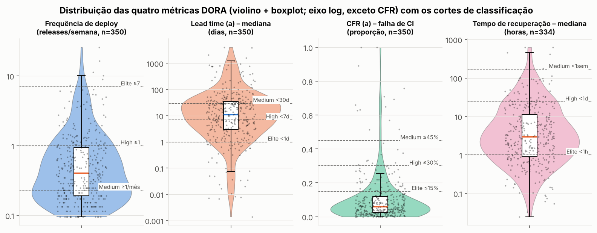
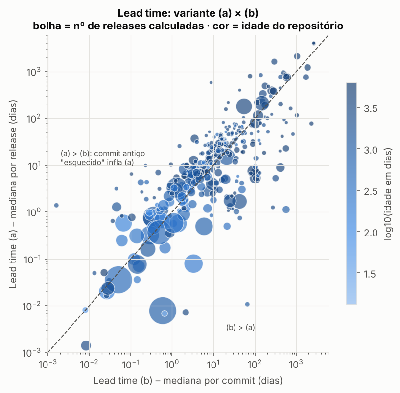
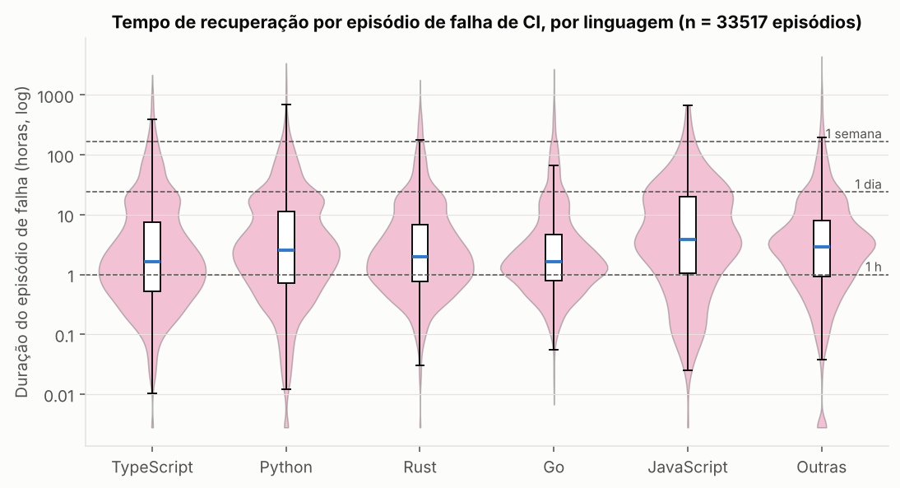
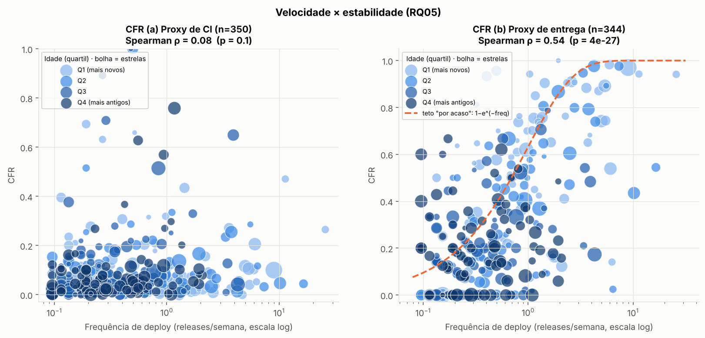
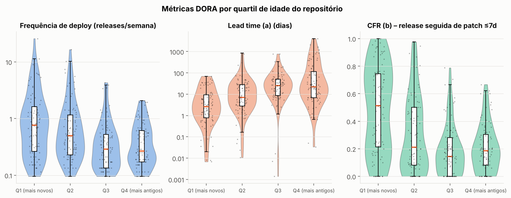
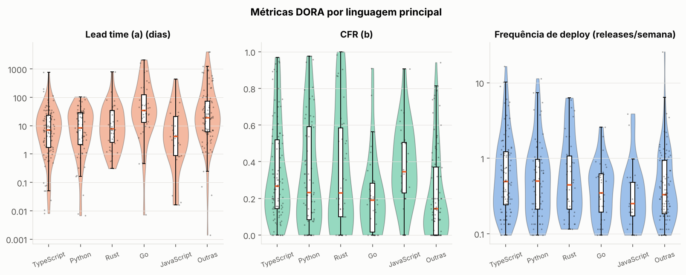
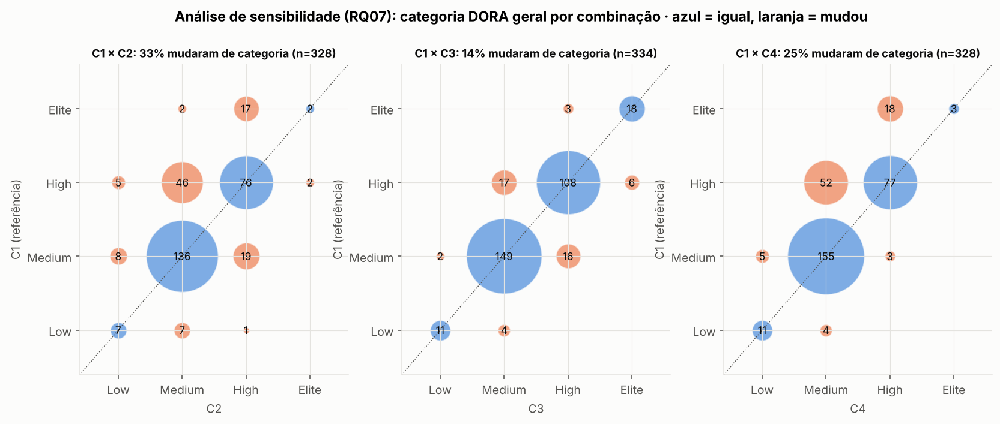

# Relatório — Mineração de Métricas DORA em Repositórios Open-Source

**Disciplina:** Laboratório de Experimentação de Software · **Laboratório 03** · Prof. Danilo Maia
**Amostra:** 350 repositórios públicos do GitHub com GitHub Actions · **Janela de observação:** 01/10/2025 a 01/10/2026 (12 meses)

---

## Sumário executivo

Calculamos as quatro métricas DORA (frequência de deploy, lead time, taxa de falha e tempo de recuperação) para 350 repositórios populares e perguntamos **o quanto podemos confiar nesses números**, já que todos são *proxies* (release ≠ deploy; falha de CI ≠ falha em produção). Os cinco achados principais:

1. **O repositório típico é "Medium" DORA.** Mediana de 0,40 release/semana, lead time de ~11 dias, falha de CI de ~6% e recuperação em ~2,8 h. Só 6 de 350 repositórios entregam ≥ 7 vezes por semana.
2. **A estabilidade de CI é excelente e a velocidade de entrega é modesta.** 77% dos repositórios com dados de CI têm falha ≤ 15% (faixa Elite); mas 30% publicam menos de 1 release por mês (faixa Low).
3. **Velocidade e estabilidade NÃO estão em trade-off quando medimos estabilidade por CI** (Spearman ρ = 0,07; p = 0,49). Isso concorda com a tese do DORA.
4. **A conclusão se inverte com outra definição de falha.** Com o proxy de entrega (release seguida de um *patch* em ≤ 7 dias), ρ = +0,54 (mais releases → "mais falhas"). Mostramos que boa parte disso é **efeito mecânico da heurística**: quem publica muito tem mais chance de publicar algo em 7 dias, independentemente de qualquer defeito. A validação contra a amostra-ouro confirma: das releases que essa regra trata como corretivas, **44% não são** (precisão 0,56; F1 0,52, abaixo do mínimo de 0,70).
5. **A classificação DORA de um repositório depende da definição operacional.** Entre 17% e 44% dos repositórios mudam de categoria conforme a combinação de definições escolhida (kappa ponderado de 0,34 a 0,78). A idade do repositório é o fator que mais se associa às métricas; as estrelas não explicam nada.

---

## 1. Contexto e problema

O DORA define quatro métricas de desempenho de entrega: duas de **velocidade** (*deployment frequency*, *lead time for changes*) e duas de **estabilidade** (*change failure rate*, tempo de recuperação). O GitHub não registra deploys nem falhas em produção, então inferimos:

| Conceito DORA | Proxy usado aqui |
|---|---|
| Deploy | Release publicada (`draft = false`, `prerelease = false`) |
| Lead time (a) | Data da release − data do commit **mais antigo** incluído nela (mediana por repositório) |
| Lead time (b) | Data da release − data de **cada commit** incluído (mediana de todos os commits) |
| CFR (a) | Execuções de CI com falha ÷ (falhas + sucessos), no default branch, evento `push` |
| CFR (b) | Releases seguidas, em ≤ 7 dias, por uma release que só muda o *patch* (SemVer) ÷ releases avaliadas |
| Recuperação | Do início da 1ª falha de um workflow até o fim da próxima execução bem-sucedida do mesmo workflow |

A pergunta central do laboratório é dupla: *qual é o valor das métricas?* e *quanto esse valor muda quando a definição muda?*

---

## 2. Dados e metodologia

### 2.1 Funil de seleção

| Etapa | Restantes | Descartados | Motivo |
|---|---:|---:|---|
| Candidatos coletados na busca | 5.347 | | |
| Avaliados (ordem aleatória, semente fixa, até atingir o alvo) | 1.185 | 4.162 | não avaliados (alvo atingido) |
| Usam GitHub Actions | 1.022 | 163 | sem workflows / erro de API |
| ≥ 5 releases publicadas na janela | 437 | 585 | releases insuficientes |
| ≥ 50 workflow runs válidos (push, default branch) | 350 | 87 | runs insuficientes |
| **Amostra final** | **350** | | |

### 2.2 O que há nos dados (e o que não há)

| Base | Cobertura | Conteúdo |
|---|---|---|
| `repos_selecionados.csv` | 350 repositórios | estrelas, linguagem, contribuidores, idade |
| `releases.csv` | 350 repos · 43.709 releases (18.564 não-pré-release na janela; 4.579 pré-releases na janela, em 132 repositórios, entram só na variante C2 da RQ07) | data, pré-release, commits incluídos, lead time por release |
| `lead_time_repos.csv` | 350 repos | lead time (a) e (b) por repositório |
| `workflow_runs_repos.csv` | **100 repos** | CFR (a), nº de episódios de falha |
| `episodios.csv` | 95 repos · 10.076 episódios | duração de cada episódio de falha de CI |

### 2.3 Como lemos os gráficos

- **Gráfico de violino:** o contorno mostra *onde os repositórios se concentram* (quanto mais largo, mais repositórios naquele valor). Dentro dele, a caixa branca mostra mediana (traço colorido) e quartis (IQR), e os pontos são os repositórios individuais. Violinos substituem a média por algo mais honesto: as métricas são muito assimétricas, e um violino mostra a forma inteira da distribuição, inclusive se há dois "grupos" (bimodalidade).
- **Gráfico de bolhas:** cada bolha é um repositório. Posição = duas métricas; **tamanho e cor** carregam mais duas informações (ex.: estrelas e idade). Serve para ver relações e *confundidores* ao mesmo tempo.
- Escalas **logarítmicas** são usadas onde os valores variam por ordens de grandeza (cada marca é 10× a anterior).
- Todas as estatísticas descritivas são **mediana (IQR)**, como pedido no roteiro.

### 2.4 Validação manual (amostra-ouro)

Sorteamos 60 repositórios entre os 348 com pelo menos 5 releases avaliáveis e 5 releases de cada um (semente 42; 300 releases). Cada item recebeu três rótulos: tipo do projeto, se as releases são entregas reais ao usuário e se a release é corretiva. A rotulagem foi feita por **avaliação automatizada com um modelo de linguagem**, que leu a lista de commits de todas as releases e as notas da release ou a seção do CHANGELOG em 232 delas, sem ver a saída da heurística. A regra de decisão, a fonte e a justificativa de cada rótulo estão em `docs/protocolo_avaliacao_automatizada.md` e `validacao/justificativas_avaliacao_automatizada.csv`.

Resultado: 113 das 300 releases (37,7%) são corretivas; 58 dos 60 repositórios têm releases que são entregas reais (as exceções são um repositório de apps de exemplo e uma newsletter). Como há um único avaliador, **o kappa de Fleiss não pôde ser calculado** (ver Ameaças).

### 2.5 Testes estatísticos (simples e não paramétricos)

Wilcoxon (uma amostra ou pareado), Spearman (correlação por postos), Kruskal-Wallis com tamanho de efeito ε² = H/(n−1), correção de Holm para 20 testes na RQ06, kappa de Cohen ponderado (linear) na RQ07 e teste binomial para a proporção de mudança de categoria. Nível de significância: 5%.

---

## 3. Hipóteses

As hipóteses abaixo decorrem da literatura DORA e do senso comum de engenharia de software. **H0** é a hipótese nula (nada de interessante acontece); **H1** é a hipótese afirmativa (o que esperamos). Elas foram testadas contra os dados na seção 4.

| RQ | Hipótese nula (H0) | Hipótese afirmativa (H1) | Teste |
|---|---|---|---|
| **01** Frequência | A mediana de releases por semana é ≥ 1 (cadência semanal ou mais rápida). | A mediana é **< 1 por semana**: projetos open-source populares entregam menos de uma vez por semana. | Wilcoxon, 1 amostra |
| **02** Lead time | As variantes (a) e (b) têm o mesmo valor típico. | (a) é **maior** que (b): um commit antigo "esquecido" infla a variante por release. | Wilcoxon pareado |
| **03** CFR | O CFR de CI (a) e o de entrega (b) são iguais. | Diferem: falhar no pipeline (a) não é o mesmo que ter de corrigir uma release (b). Além disso, esperamos CFR (a) mediano ≤ 15% (Elite). | Wilcoxon pareado e 1 amostra |
| **04** Recuperação | A mediana do tempo de recuperação é ≥ 1 dia. | A mediana é **< 1 dia**: falhas de CI em projetos populares são resolvidas rápido. | Wilcoxon, 1 amostra |
| **05** Velocidade × estabilidade | ρ ≥ 0: mais deploys não se associam a menos falhas. | **ρ < 0**: repositórios que entregam mais vão melhor também na estabilidade (tese do DORA). | Spearman |
| **06** Características | A distribuição da métrica é a mesma em todos os grupos do fator. | Há diferença entre grupos (esperamos efeito de idade e popularidade). | Kruskal-Wallis + Holm + ε² |
| **07** Sensibilidade | No máximo 10% dos repositórios mudam de categoria quando a definição muda (classificação robusta). | **Mais de 10%** mudam (classificação sensível à definição). | Binomial + kappa ponderado |

---

## 4. Resultados por questão de pesquisa

### RQ01 — Frequência de deploy

| Métrica | n | Q1 | **Mediana** | Q3 |
|---|---:|---:|---:|---:|
| Releases por semana | 350 | 0,19 | **0,40** | 0,94 |

A mediana equivale a **uma release a cada ~2,5 semanas**. Pelos cortes DORA: 6 repositórios (2%) são Elite (≥ 7/semana), 22% são High, 46% Medium e 30% Low (< 1 por mês). Apenas 23% publicam ao menos uma release por semana.

**Teste:** Wilcoxon contra 1 release/semana → p = 5,5·10⁻¹⁵. **Rejeitamos H0**: a cadência típica é bem inferior a semanal.



**Leitura da figura 1 (primeiro painel):** o violino de frequência é largo na base (muitos repositórios entre 0,1 e 0,5 release/semana) e tem uma cauda fina que sobe até ~26/semana. A cauda é feita por poucos projetos que publicam quase automaticamente a cada mudança (ex.: `antiwork/gumroad`, ~1.240 releases no ano). A maioria dos pontos fica **abaixo** da linha "High ≥ 1".

### RQ02 — Lead time

| Variante | n | Q1 | **Mediana** | Q3 |
|---|---:|---:|---:|---:|
| (a) por release (dias) | 350 | 3,0 | **10,9** | 35,2 |
| (b) por commit (dias) | 350 | 2,5 | **11,7** | 36,6 |

- Correlação entre as variantes: ρ = 0,74 (relação forte, mas longe de idêntica).
- Em **63% dos repositórios** (a) > (b); a razão mediana (a)/(b) é 1,36. Wilcoxon pareado unilateral: p = 5·10⁻⁴ → **rejeitamos H0**.
- Pelos cortes DORA, só 13% dos repositórios têm lead time < 1 dia (Elite) e 29% têm ≥ 30 dias (Low).



**Leitura da figura 2:** cada bolha é um repositório, e a diagonal tracejada marca "(a) = (b)". Os repositórios seguem a diagonal (por isso ρ = 0,74), mas **o enxame fica levemente acima dela** quando o lead time é grande: ali, um único commit antigo incluído na release puxa a variante (a) para cima, enquanto a mediana por commit (b) quase não se mexe. As bolhas grandes (repositórios com muitas releases) ficam perto da diagonal, porque a mediana de muitas releases suaviza esse efeito. A cor mostra um padrão adicional: **os repositórios mais novos (azul claro) estão no canto inferior esquerdo** (lead times de horas a poucos dias), e os mais antigos (azul escuro) no canto superior direito.

**Qualidade dos dados de lead time:** 2.436 de 18.493 releases (13%) não trazem commits novos em relação à anterior e foram excluídas do cálculo; 62 eram a primeira release do repositório; 7 tiveram erro 404 de `compare`. Também há **10.156 commits com lead time negativo** (0,36% de 2,8 milhões), concentrados em 25 repositórios: é sintoma de rebase, *squash* ou data de autor posterior à da release.

### RQ03 — Taxa de falha das mudanças (CFR)

| Variante | n | Q1 | **Mediana** | Q3 |
|---|---:|---:|---:|---:|
| (a) Proxy de CI | 100 | 3,0% | **6,2%** | 13,3% |
| (b) Proxy de entrega (patch ≤ 7 dias) | 344 | 8,7% | **20,0%** | 48,8% |

- **CFR (a):** 77 dos 100 repositórios ficam na faixa Elite (≤ 15%); só 6 passam de 45%. O teste de "mediana > 15%" não é rejeitado a favor de H1 (p ≈ 1): confirmamos que o valor típico está **abaixo** do corte Elite.
- **CFR (b):** 64 repositórios têm 0% e 15 passam de 90%, uma distribuição em "U" (ver figura 3, terceiro painel). Seis repositórios não puderam ser avaliados (menos de 5 releases avaliáveis ou tags fora do padrão SemVer).
- **Comparação pareada** (99 repositórios com as duas variantes): medianas de 6,3% (a) e 21,7% (b), Wilcoxon p = 8·10⁻⁸. **Rejeitamos H0**: as variantes medem coisas diferentes.

**Por que divergem?** O CFR (a) mede *falha de pipeline*, que o desenvolvedor vê e corrige antes de publicar (um teste vermelho no PR não vira incidente). O CFR (b) tenta enxergar o que "escapou" para o usuário, mas é uma heurística grosseira: **a metade das releases (mediana de 50%) é seguida por outra release em ≤ 7 dias**, e em cerca de 75% desses casos a seguinte é só um *patch bump*. Projetos que publicam uma versão de patch a cada commit (ex.: `v0.2.11 → v0.2.12`) são marcados como "falhando" quase 100% do tempo sem que haja evidência de defeito.

**Validação contra a amostra-ouro.** Tratando como "corretiva" toda release que a regra usa para marcar uma falha (um *patch* da mesma linha publicado em ≤ 7 dias), a comparação com os 300 rótulos dá:

| VP | FP | FN | VN | Precisão | Recall | F1 |
|---:|---:|---:|---:|---:|---:|---:|
| 55 | 43 | 58 | 144 | 0,56 | 0,49 | **0,52** |

- **Falsos positivos (43):** são *patches* que trazem funcionalidades novas, comuns em projetos que só incrementam o *patch* (versões 0.x e monorepos com *changesets*). Como cada falso positivo faz uma release R contar como falha, **o CFR (b) desta seção está superestimado**: quase metade das "correções" que o alimentam não corrige nada.
- **Falsos negativos (58):** 45 são *patches* corretivos publicados mais de 7 dias depois da release anterior da linha (comuns em linhas LTS e de *backports*), e 13 não são *patch bumps* (ex.: uma *minor* só com correções). Esses casos não mudam o CFR (b), porque fora da janela de 7 dias nada conta como falha, mas pesam no *rework rate*.
- Sem o prazo de 7 dias, o critério de versão sozinho acerta mais: 100 das 171 releases que são *patch* da mesma linha são corretivas, e 100 das 113 corretivas são *patches*.

A comparação com as demais versões da heurística, que também olham as mensagens dos commits, está em `docs/heuristica_corretiva.md`.

### RQ04 — Tempo de recuperação

| Nível | n | Q1 | **Mediana** | Q3 |
|---|---:|---:|---:|---:|
| Por repositório (mediana dos episódios, horas) | 95 | 0,9 | **2,8** | 10,6 |
| Por episódio de falha (horas) | 10.051 | 0,8 | **2,5** | 7,9 |

- 89% dos repositórios têm mediana < 1 dia e 27% têm mediana < 1 hora. Wilcoxon (mediana < 24 h): p = 10⁻⁹ → **rejeitamos H0**.
- Por episódio: 29% se resolvem em < 1 h, 11% duram mais de 1 dia, e o percentil 90 é de 25 h.
- **Censura:** apenas 25 dos 10.076 episódios (0,25%) não terminaram na janela, e foram mantidos fora da mediana, mas contabilizados aqui. O viés é desprezível.



**Leitura da figura 6:** o violino por episódio é **bimodal** (dois "calombos") em TypeScript, Python e Go: um grupo de falhas que se resolve em ~1 h (reexecução, *flaky test*, correção trivial) e outro em ~15–20 h (correção que exige trabalho e costuma ficar para o dia seguinte). A mediana fica entre as duas bossas (~2,5 h), e é por isso que a mediana sozinha esconde essa estrutura. JavaScript tem poucos episódios (54) e parece mais rápido (0,4 h), mas essa amostra é pequena. Atenção: poucos repositórios muito ativos contribuem com milhares de episódios, de modo que o gráfico é por episódio, não por repositório.

### RQ05 — Velocidade × estabilidade

| Frequência de deploy × … | n | Spearman ρ | p-valor |
|---|---:|---:|---:|
| CFR (a), proxy de CI | 100 | **+0,07** | 0,49 |
| CFR (b), proxy de entrega | 344 | **+0,54** | 4·10⁻²⁷ |



**Leitura da figura 5.** Cada bolha é um repositório; o tamanho é o número de estrelas e a cor é a idade (mais escuro = mais antigo).

- **Painel esquerdo (CFR de CI):** a nuvem é horizontal. Repositórios que entregam 0,1 ou 10 vezes por semana têm praticamente o mesmo CFR (quase todos abaixo de 20%). **Não há trade-off** entre velocidade e estabilidade, o que sustenta a afirmação do DORA. Mas **também não confirmamos H1** (ρ < 0): a relação é nula, não negativa. Rejeitamos H1.
- **Painel direito (CFR de entrega):** a nuvem sobe junto com a frequência (ρ = 0,54). A curva laranja tracejada, **1 − e^(−frequência)**, é o que esperaríamos *por pura aritmética*: se um repositório publica uma release por semana ao acaso, a chance de sair outra em ≤ 7 dias já é de 63%. Boa parte das bolhas acompanha essa curva, o que indica que **o ρ positivo é em grande parte efeito da definição, não de qualidade pior**. Medimos isso diretamente: a frequência correlaciona ρ = 0,75 com "a release foi seguida de qualquer outra em 7 dias", e a fração *dessas* que são patches cai levemente com a frequência (ρ = −0,17).
- **A idade é um confundidor.** A correlação do painel direito cai conforme o repositório envelhece: ρ = 0,65 (Q1 – mais novos), 0,65 (Q2), 0,38 (Q3) e **0,09, não significativo, nos mais antigos (Q4)**. Repositórios jovens publicam muito e em *patches* sucessivos; nos maduros, a heurística quase não distingue velocidade de falha. Já no CFR de CI, só o quartil mais antigo mostra correlação positiva (ρ = 0,50), mas com apenas 20 repositórios.
- Repositórios com ≥ 1 release/semana têm CFR (b) mediano de 58%, contra 18% nos mais lentos, mas, como vimos, essa diferença é largamente aritmética.

**Conclusão da RQ05:** os dados **não contradizem** o DORA (não há trade-off pelo critério de CI), mas **a resposta depende da métrica de falha**. Com o proxy de entrega, a evidência é contaminada pela própria definição.

### RQ06 — Características associadas ao desempenho

Quatro fatores (linguagem — 5 principais + "Outras"; quartis de estrelas, de contribuidores e de idade) × cinco métricas = 20 testes de Kruskal-Wallis, com correção de Holm. ε² é o tamanho de efeito (convenção usual: ~0,01 pequeno, ~0,06 médio, ≥ 0,14 grande).

| Fator | Métrica | n | ε² | p (Holm) | Conclusão |
|---|---|---:|---:|---:|---|
| **Idade** | Frequência de deploy | 350 | 0,094 | < 0,001 | **Significativo** (médio) |
| **Idade** | Lead time (a) | 350 | **0,203** | < 0,001 | **Significativo (grande)** |
| **Idade** | CFR (b) | 344 | **0,144** | < 0,001 | **Significativo (grande)** |
| **Contribuidores** | Lead time (a) | 350 | 0,103 | < 0,001 | **Significativo** (médio) |
| **Linguagem** | Lead time (a) | 350 | 0,098 | < 0,001 | **Significativo** (médio) |
| **Linguagem** | CFR (b) | 344 | 0,062 | 0,011 | **Significativo** (médio) |
| Idade | Recuperação | 95 | 0,107 | 0,257 | Não significativo após Holm (bruto: p = 0,018) |
| Estrelas | todas as 5 métricas | 95–350 | 0,001–0,030 | 1,0 | **Nenhum efeito** |
| Linguagem / contribuidores / idade | CFR (a) e Recuperação (n = 95–100) | | 0,00–0,06 | ≥ 0,26 | Sem poder estatístico |

Os outros 14 testes têm p (Holm) ≥ 0,26. **Rejeitamos H0 em 6 dos 20 testes**; em todos os demais não há evidência.



**Leitura da figura 3 (idade):** os três violinos contam a mesma história em ordem de idade. **Repositórios novos** (Q1) publicam mais (mediana 0,77 release/semana contra 0,27 nos mais antigos), têm lead time curto (2,6 dias contra 22–26 dias) e um CFR (b) muito alto e muito disperso (mediana 51%, violino largo de 0 a 100%). **Repositórios maduros** publicam menos, demoram mais para levar um commit à release (muitas vezes com *release branches* e ciclos de estabilização) e têm CFR (b) baixo (14–19%). É um padrão coerente de ciclo de vida: projetos jovens iteram rápido e em *patches* sucessivos; projetos maduros entregam em lotes maiores.



**Leitura da figura 4 (linguagem):** **Go** tem o lead time mais longo (mediana 34 dias) e **JavaScript** o mais curto (4,2 dias). O CFR (b) é mais alto em JavaScript (34%) e mais baixo em "Outras" (14%). Frequência de deploy não difere por linguagem (p bruto = 0,059; Holm = 0,71).

**Contribuidores:** quanto mais contribuidores, **maior** o lead time (mediana de 5,1 dias no quartil com menos contribuidores contra 24,5 dias no quartil com mais), possivelmente por mais revisão e coordenação, e também (efeito inverso) CFR (b) menor (29% → 17%, não significativo após Holm).

**Popularidade (estrelas) não prevê nada.** Isso é um achado em si: ter muitas estrelas não implica melhor desempenho de entrega.

> Observação: idade, número de contribuidores e linguagem estão correlacionados entre si (projetos maduros têm mais contribuidores). Os testes são univariados, então **não separam o efeito de cada fator**; a idade é o candidato mais forte por ter os maiores ε².

### RQ07 — Sensibilidade da classificação DORA

Construímos quatro combinações de definições. Todas usam recuperação de CI (única definição disponível) e a classificação geral é a mediana (arredondada para baixo) das quatro notas, conforme o roteiro. Só os 95 repositórios com dados de CI **e** ao menos um episódio de falha entram nesta análise.

| Combinação | Unidade de deploy | Lead time | CFR |
|---|---|---|---|
| **C1** (referência) | release | (a) | (a) |
| **C2** | release + pré-release | (b) | (b) |
| **C3** | release | (b) | (a) — muda só o lead time |
| **C4** | release | (a) | (b) — muda só o CFR |

> A variante "tag" do roteiro não pôde ser calculada: `tags.csv` não traz datas.

**Distribuição da categoria geral (repositórios):**

| Combinação | Low | Medium | High | Elite | n |
|---|---:|---:|---:|---:|---:|
| C1 | 6 | 45 | 35 | 9 | 95 |
| C2 | 6 | 51 | 37 | **0** | 94 |
| C3 | 4 | 44 | 39 | 8 | 95 |
| C4 | 6 | 60 | 27 | 1 | 94 |

**Concordância entre pares:**

| Par | % que mudou de categoria | κ ponderado | Leitura (Landis & Koch) | p (H0: mudança ≤ 10%) |
|---|---:|---:|---|---:|
| C1 × C3 (só lead time) | **17%** | **0,78** | substancial | 0,026 |
| C2 × C4 | 23% | 0,60 | moderada/substancial | 1·10⁻⁴ |
| C1 × C4 (só CFR) | 32% | 0,55 | moderada | 5·10⁻⁹ |
| C2 × C3 | 33% | 0,50 | moderada | 1·10⁻⁹ |
| C3 × C4 | 38% | 0,45 | moderada | 3·10⁻¹³ |
| **C1 × C2** (tudo muda) | **44%** | **0,34** | razoável | 3·10⁻¹⁷ |



**Leitura da figura 7:** cada bolha é um conjunto de repositórios cuja categoria na referência (eixo vertical) e na variante (eixo horizontal) são aquelas mostradas; o tamanho e o número dentro da bolha são a contagem. **Azul = classificação mantida** (sobre a diagonal), **laranja = mudou**.

- **C1 × C3** (troca só a variante de lead time): quase tudo na diagonal. O lead time é a definição **menos sensível**.
- **C1 × C4** (troca só o CFR): 17 repositórios "High" caem para "Medium" e **8 "Elite" caem para "High"**. A bolha laranja acima da diagonal mostra que o CFR (b) é sistematicamente mais severo do que o CFR (a).
- **C1 × C2**: nenhum repositório é Elite em C2 (contra 9 em C1), e 44% mudam de categoria.

**Rejeitamos H0 em todos os pares**: a classificação é sensível à definição. A escolha do **proxy de falha** é a mais importante: ela sozinha desloca 32% dos repositórios, enquanto a variante de lead time desloca 17%.

**Robustez das conclusões anteriores:** as RQ 01, 02 e 04 (descrição de uma métrica) são estáveis; a **RQ05 não é robusta** (ρ = 0,07 vs. 0,54), e parte da RQ06 que usa CFR (b) deve ser lida com cautela.

---

## 5. Discussão: hipóteses × resultados

| RQ | Esperado (H1) | Encontrado | Surpresa? |
|---|---|---|---|
| 01 | Menos de 1 release/semana | Confirmado (mediana 0,40; p ≈ 10⁻¹⁵) | Não. A surpresa é a cauda: 6 projetos acima de 7/semana, quase automáticos. |
| 02 | (a) > (b) | Confirmado, mas o efeito é **pequeno** (razão 1,36) | Sim: esperávamos divergência maior; com a mediana, o "commit esquecido" pesa pouco. |
| 03 | CFR (a) ≠ (b); (a) ≤ 15% | Confirmado (6% vs 22%) | Moderada: o proxy de entrega é muito severo, e a causa está na heurística. |
| 04 | Recuperação < 1 dia | Confirmado (mediana 2,5–2,8 h) | A **bimodalidade** da distribuição não foi antecipada. |
| 05 | ρ < 0 | **Rejeitado**: ρ ≈ 0 (CI) e ρ > 0 (entrega) | **Sim.** O resultado positivo é em boa parte aritmética da definição. |
| 06 | Idade e popularidade importam | **Só a idade** (e contribuidores/linguagem em lead time); estrelas não | **Sim.** Popularidade não prevê desempenho. |
| 07 | Classificação sensível | Confirmado: 17–44% mudam | Menos do que o esperado para o lead time, mais do que o esperado para o CFR. |

**Mensagem principal:** o DORA ajuda a *comparar*, mas, com dados do GitHub, **o valor absoluto de uma métrica depende tanto da definição quanto do repositório**. As conclusões mais confiáveis são as que se repetem em mais de uma definição: (i) cadência de release lenta na maioria dos projetos, (ii) CI estável com recuperação rápida, e (iii) forte relação das métricas com a idade do projeto.

---

## 6. Ameaças à validade

**Construto (estamos medindo o que achamos?)**
- *Release ≠ deploy.* Bibliotecas e ferramentas publicam versões, mas quem faz deploy em produção são os usuários. A "frequência de deploy" é, na prática, frequência de **publicação**.
- *CFR (a) mede pipeline, não produção.* Uma falha de CI é muitas vezes corrigida antes de qualquer usuário ser afetado.
- *A heurística do CFR (b) não atinge o mínimo de validade.* Contra a amostra-ouro, a regra "patch ≤ 7 dias" tem precisão 0,56 e F1 0,52 (meta ≥ 0,70). Ela não olha as mensagens de commit (`fix`, `revert`, `hotfix`) e marca como falha projetos que fazem releases contínuas de *patch*. **Os valores de CFR (b) são um teto, não uma estimativa.**
- *A amostra-ouro tem um único avaliador automatizado.* Os rótulos vieram de um modelo de linguagem, não de três pessoas, então não há kappa de Fleiss para medir quanto o critério "release corretiva" é ambíguo. Os casos de fronteira são as releases mistas, com correções e funcionalidades na mesma versão.
- *Datas de commit.* `author.date` é distorcida por rebase/squash: há 10.156 commits com lead time negativo.

**Interna (há fatores não controlados?)**
- *Idade* é confundidor de várias análises: é correlacionada com frequência, lead time, CFR (b) e provavelmente com contribuidores. A RQ06 compara um fator de cada vez.
- 13% das releases (2.436) não trazem commits novos e foram excluídas do lead time, o que pode enviesar o resultado de projetos que republicam sem alteração.
- A variação de frequência entre projetos é de 270× (0,1 a 26 releases/semana); repositórios hiperativos geram milhares de episódios de CI e dominam a análise por episódio (fig. 6).

**Externa (vale além da amostra?)**
- Amostra de repositórios **muito populares** (≥ 1.915 estrelas), **open-source** e **com GitHub Actions**. Projetos corporativos fechados, com deploys de verdade em produção, podem ser muito diferentes.
- Os dados de CI cobrem 100 dos 350 repositórios (embora o subconjunto seja similar no perfil), e o grupo JavaScript tem só 6 repositórios com CI.
- Recorte único de 12 meses, que reflete um estado da evolução do ecossistema (grande presença de projetos de IA muito novos e ativos).

**De conclusão (a análise é adequada?)**
- Usamos testes não paramétricos e mediana/IQR; com 20 testes na RQ06 aplicamos Holm. Mesmo assim, p-valores minúsculos em n = 344 refletem poder estatístico, não necessariamente relevância prática: por isso reportamos ε² e ρ.
- Os subgrupos de CI (n = 95–100 divididos em 4–6 grupos) têm pouco poder: "não significativo" ali **não** significa "sem efeito".
- Os episódios de falha são aninhados em repositórios (pseudorreplicação), o que torna o p-valor da análise por episódio otimista; por isso os testes foram feitos por repositório.
- O corte de lead time (mediana) limita a influência de *outliers* de até 4.000 dias, mas os cortes DORA usados são os fixos da disciplina (adaptados), não os de *clusters* anuais do relatório DORA.

---

## 7. Conclusão

1. **Quadro geral:** repositórios populares são, tipicamente, *Medium* DORA, com CI estável e recuperação rápida, mas com cadência de release lenta e lead times de dias a semanas.
2. **Velocidade × estabilidade:** não há evidência de trade-off medindo estabilidade pelo CI (ρ = 0,07). O sinal positivo (ρ = 0,54) do proxy de entrega é principalmente artefato da heurística.
3. **Quem vai melhor?** A idade do repositório é o fator mais associado (ε² até 0,20); linguagem e número de contribuidores importam para o lead time; **estrelas não importam**.
4. **Confiança nos números:** a mesma amostra produz de 17% a 44% de mudança de categoria conforme as definições operacionais. A escolha do proxy de falha pesa mais que a do lead time.

**Próximos passos sugeridos:** (i) avaliar contra a amostra-ouro as versões da heurística corretiva que usam mensagens de commit e recalcular o CFR (b) com a que tiver o melhor F1; (ii) coletar CI para os 250 repositórios restantes; (iii) incluir *tags* com datas para completar a sensibilidade; (iv) usar modelos que controlem idade e linguagem juntas; (v) testar o bônus de evolução trimestral (RQ08).

---

## Apêndice — Reprodução

Arquivos gerados junto deste relatório:

| Arquivo | Conteúdo |
|---|---|
| `src/metricas.py` | calcula, por repositório, frequência, lead time, CFR (a/b), recuperação e classificações C1–C4 → `metricas.csv` |
| `src/analise.py` | RQ05, RQ06 (Kruskal-Wallis, ε², Holm) e RQ07 (kappa) |
| `src/graficos.py` | gera todas as figuras de `figs/` e os números complementares |
| `rq06_testes.csv` | tabela completa dos 20 testes da RQ06 |
| `metricas_enriquecido_2.csv` | tabela final por repositório (uma linha por repositório) |
| `validacao/amostra_ouro.csv`, `sorteio.json` | sorteio da amostra-ouro (`src/amostra_ouro.py`, semente 42) |
| `validacao/rotulos_avaliacao_automatizada.csv` | rótulos das 300 releases; justificativas em `justificativas_avaliacao_automatizada.csv` |
| `src/avaliar_heuristica.py` | precisão, recall e F1 de cada versão da heurística corretiva contra os rótulos |

```bash
python3 src/metricas.py data/data metricas.csv
python3 src/analise.py metricas.csv
python3 src/graficos.py data/data metricas_enriquecido.csv figs
```

Parâmetros: janela de 01/10/2025 a 01/10/2026 (365 dias = 52,14 semanas); releases publicadas (`draft = false`, `prerelease = false`); CFR (b) exige ≥ 5 releases avaliáveis e ignora releases dos últimos 7 dias da janela; classificação DORA com os cortes fixos do roteiro (nota 4/3/2/1 por métrica, mediana arredondada para baixo).
